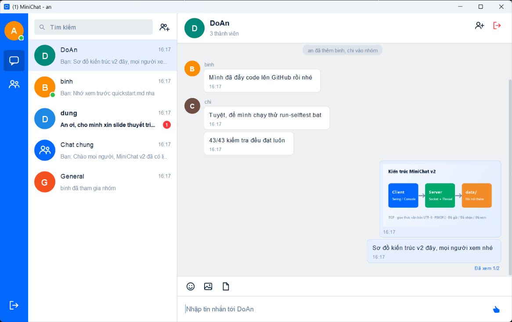
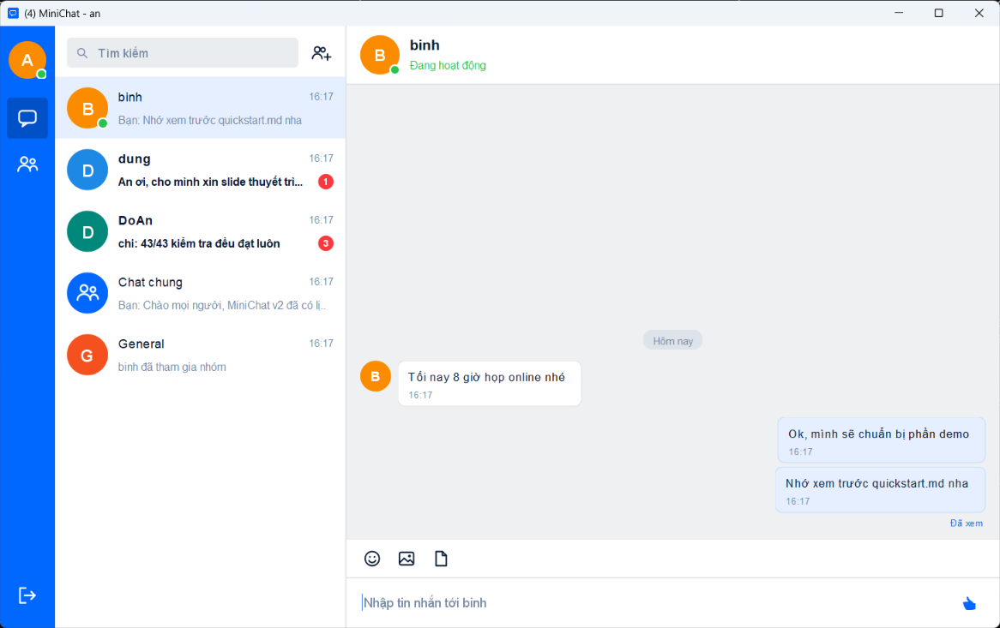
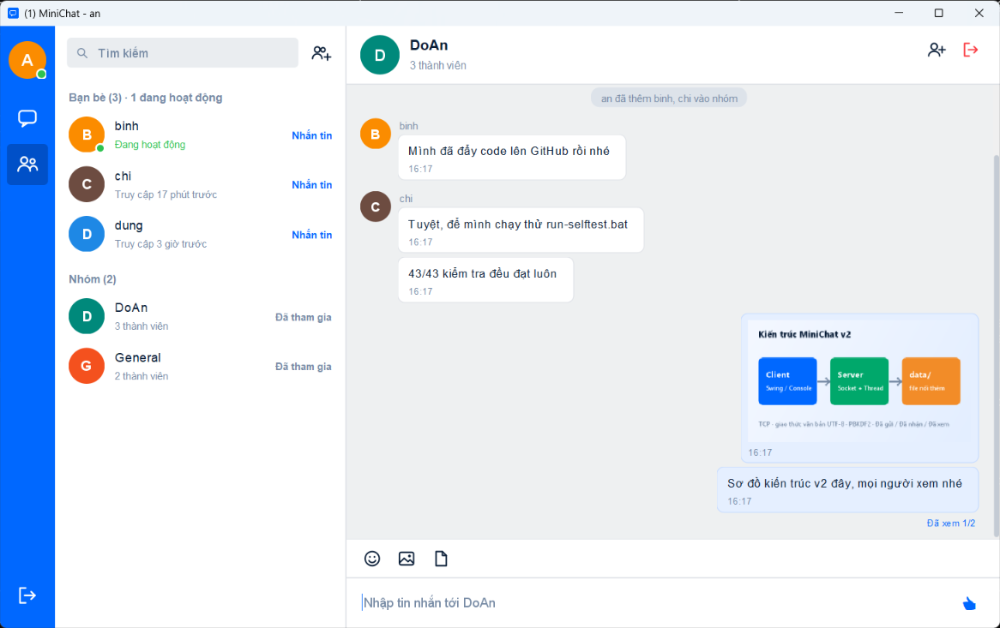
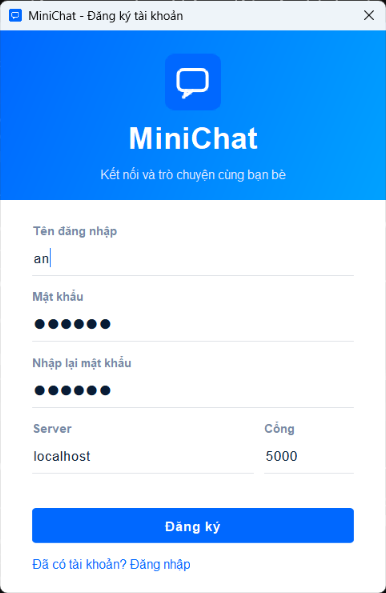
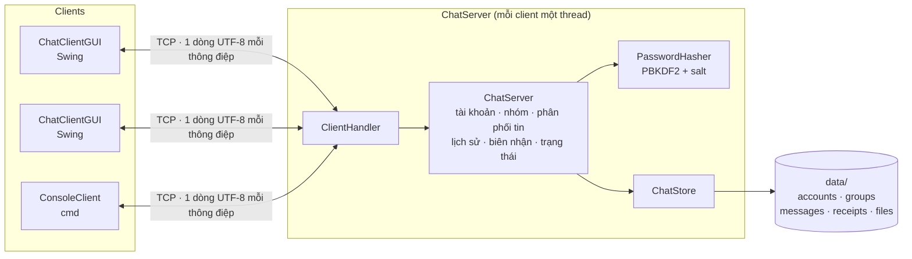
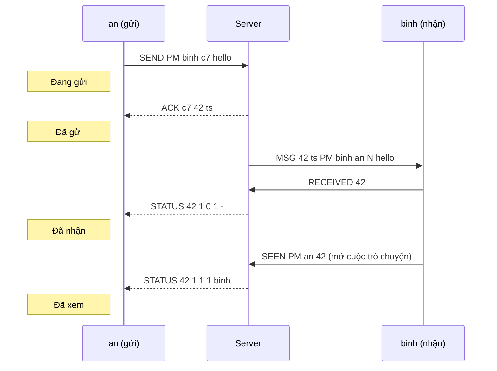

<div align="center">

# 💬 MiniChat

**Ứng dụng chat Client/Server viết hoàn toàn bằng Java Socket + Swing, giao diện phong cách Zalo**

Chat chung · Chat nhóm · Chat riêng · Gửi ảnh/file · Tài khoản · Lịch sử tin nhắn · Trạng thái hoạt động · Đã gửi / Đã nhận / Đã xem




</div>

---

## 📑 Mục lục

- [Ảnh chụp màn hình](#-ảnh-chụp-màn-hình)
- [Tính năng](#-tính-năng)
- [Bắt đầu nhanh](#-bắt-đầu-nhanh)
- [Hướng dẫn sử dụng](#-hướng-dẫn-sử-dụng)
- [Kiến trúc](#-kiến-trúc)
- [Giao thức](#-giao-thức)
- [Lưu trữ dữ liệu](#-lưu-trữ-dữ-liệu)
- [Kiểm thử](#-kiểm-thử)
- [Cấu trúc project](#-cấu-trúc-project)
- [Quy trình phát triển (Spec Kit)](#-quy-trình-phát-triển-spec-kit)

---

## 📸 Ảnh chụp màn hình

| Chat riêng – trạng thái **Đã xem** | Danh bạ – **Đang hoạt động / Truy cập N phút trước** |
|:---:|:---:|
|  |  |

| Đăng ký tài khoản | Chat nhóm – **Đã xem 1/2**, gửi ảnh |
|:---:|:---:|
|  |  |

---

## ✨ Tính năng

### 💬 Trò chuyện
| | Tính năng | Mô tả |
|---|---|---|
| 🌐 | **Chat chung** | Gửi tin tới tất cả mọi người |
| 👥 | **Chat nhóm** | Tạo nhóm kèm chọn thành viên, thêm thành viên, tham gia / rời nhóm (kể cả thành viên đang offline) |
| 🔒 | **Chat riêng** | Nhắn cho một người, **kể cả khi người đó offline**: tin được giao khi họ đăng nhập |
| 🖼️ | **Ảnh / file** | Ảnh hiện ngay trong khung chat (nhấp để xem lớn, lưu về máy); file tối đa 5 MB |
| 😀 | **Emoji & 👍 nhanh** | Bảng chọn biểu cảm; ô nhập trống thì nút gửi là 👍 |
| ✍️ | **Đang soạn tin** | Hiện "X đang soạn tin..." cho người cùng cuộc trò chuyện |
| 🔔 | **Thông báo** | Đếm tin chưa đọc, sắp xếp theo tin mới nhất, thông báo ở khay hệ thống |

### 🆕 Tài khoản, lịch sử và trạng thái
| | Tính năng | Mô tả |
|---|---|---|
| 🔑 | **Đăng ký / đăng nhập** | Mật khẩu 6–50 ký tự, băm **PBKDF2-HMAC-SHA256 + salt** (không lưu mật khẩu gốc); mỗi tài khoản chỉ đăng nhập ở một nơi |
| 🗂️ | **Lịch sử tin nhắn** | Tin nhắn, ảnh, file, nhóm được lưu trong `data/`; đăng nhập lại hoặc **khởi động lại server vẫn còn nguyên** |
| 🟢 | **Trạng thái hoạt động** | "Đang hoạt động" (chấm xanh) hoặc "Vừa truy cập" / "Truy cập N phút · giờ · ngày trước", tự cập nhật |
| ✅ | **Trạng thái tin nhắn** | `Đang gửi → Đã gửi → Đã nhận → Đã xem`; nhóm hiện **Đã xem K/N** (di chuột để xem ai đã xem); lỗi thì **Gửi thất bại** |

### 🖥️ Hai loại client
- **`ChatClientGUI`**: giao diện Swing phong cách Zalo (khuyên dùng).
- **`ConsoleClient`**: chạy trên cmd, dùng chung phần kết nối mạng.

---

## 🚀 Bắt đầu nhanh

> **Yêu cầu:** JDK 17 trở lên. Không cần Maven/Gradle hay thư viện ngoài.

```powershell
git clone https://github.com/TrungNguyen410/MiniChat.git
cd MiniChat
.\build.bat                                          # biên dịch vào bin/
```

Mở **mỗi chương trình trong một terminal riêng**:

```powershell
java -cp bin minichat.server.ChatServer             # 1. server (cổng 5000)
java -cp bin minichat.client.ChatClientGUI          # 2. client giao diện (mở nhiều lần = nhiều người)
java -cp bin minichat.client.ConsoleClient          # 3. client dòng lệnh (tuỳ chọn)
```

Hoặc mở server và 3 client chỉ bằng một lệnh PowerShell:

```powershell
Start-Process cmd -ArgumentList '/k','chcp 65001 > nul & java -cp bin minichat.server.ChatServer'; Start-Sleep 2; 1..3 | ForEach-Object { Start-Process javaw -ArgumentList '-cp','bin','minichat.client.ChatClientGUI' }
```

<details>
<summary><b>Các cách chạy khác (file .bat, Eclipse, VS Code, mạng LAN)</b></summary>

| Cách | Làm gì |
|---|---|
| **File .bat** | Nhấp đúp `run-server.bat`, sau đó `run-client.bat` (hoặc `run-console-client.bat`) nhiều lần |
| **Eclipse** | `File > Import > Existing Projects into Workspace` → chọn thư mục `MiniChat` → chạy `ChatServer`, rồi `ChatClientGUI` |
| **VS Code** | Tab *Run and Debug* → chọn **Server + 2 Client** |
| **Mạng LAN** | Ở ô *Server* khi đăng nhập, nhập IP của máy chạy server, hoặc `java -cp bin minichat.client.ChatClientGUI 192.168.1.10 5000` |
| **Đổi cổng / thư mục dữ liệu** | `java -cp bin minichat.server.ChatServer 6000 data-test` |
| **Xoá dữ liệu, làm lại từ đầu** | Tắt server rồi xoá thư mục `data/` |

> 💡 Nếu thư mục chứa project có dấu tiếng Việt, hãy `cd` vào project rồi dùng `-cp bin` (đường dẫn tương đối). Gõ `chcp 65001` trước để terminal hiện đúng tiếng Việt.

</details>

---

## 📖 Hướng dẫn sử dụng

### Client giao diện
1. **Lần đầu:** bấm **"Chưa có tài khoản? Đăng ký ngay"**, nhập tên (không dấu cách), mật khẩu, rồi nhập lại mật khẩu.
2. **Những lần sau:** đăng nhập bằng tên và mật khẩu đó.
3. **Thanh bên xanh:** tab **Tin nhắn**, tab **Danh bạ**, nút **Đăng xuất**.
4. **Tab Tin nhắn:** cuộc trò chuyện xếp theo tin mới nhất, chấm đỏ là số tin chưa đọc; ô tìm kiếm gõ không dấu cũng được.
5. **Tab Danh bạ:** mọi tài khoản, người đang online xếp trước; bấm vào một người để chat riêng, bấm vào nhóm để tham gia.
6. **Tạo nhóm:** nút cạnh ô tìm kiếm. Trong nhóm có nút **Thêm thành viên** và **Rời nhóm**.
7. **Trạng thái tin** hiện dưới tin cuối bạn gửi. "Đã xem" được tính khi người nhận mở cuộc trò chuyện trong lúc cửa sổ MiniChat đang được chọn.

### Client dòng lệnh
Khi mở, chọn `1` để đăng nhập hoặc `2` để đăng ký (mật khẩu không hiện khi gõ). Lịch sử được in kèm giờ, tin chưa đọc có chữ *mới*.

| Lệnh | Ý nghĩa |
|---|---|
| `<tin nhắn>` | chat chung |
| `/g <nhóm> <tin nhắn>` | chat nhóm |
| `/pm <user> <tin nhắn>` | chat riêng (kể cả khi người đó offline) |
| `/create <nhóm>` · `/join <nhóm>` · `/leave <nhóm>` | tạo / vào / rời nhóm |
| `/users` | mọi tài khoản kèm trạng thái hoạt động |
| `/groups` | danh sách nhóm |
| `/quit` | thoát |

---

## 🏗️ Kiến trúc



### Vòng đời một tin nhắn



Nếu `binh` đang offline, server lưu tin lại và gửi đi khi `binh` đăng nhập (kèm cờ `U`, tức là chưa đọc).

---

## 🔌 Giao thức

Mỗi thông điệp là **một dòng văn bản UTF-8**. Các trường cách nhau bằng dấu cách, trường cuối được phép chứa dấu cách.
`<loại>` là `ALL` (đích `*`), `GROUP` (đích là tên nhóm) hoặc `PM` (đích là tên người nhận). File được mã hoá Base64.

<details>
<summary><b>Bảng lệnh đầy đủ</b></summary>

| Client → Server | Server → Client |
|---|---|
| `REGISTER <tên> <mật khẩu>` / `LOGIN <tên> <mật khẩu>` | `LOGIN_OK <tên> <giờ server>` / `ERROR <lý do>`, rồi danh sách và lịch sử |
| `CREATE <nhóm> [u1,u2]` | `JOINED <nhóm>` (gửi người tạo và các thành viên đang online) |
| `ADD <nhóm> <user>` | `JOINED <nhóm>` + lịch sử nhóm (gửi user được thêm) |
| `JOIN <nhóm>` / `LEAVE <nhóm>` | `JOINED <nhóm>` + lịch sử nhóm / `LEFT <nhóm>` |
| `SEND <loại> <đích> <cid> <tin>` | `ACK <cid> <id> <ts>` hoặc `NACK <cid> <lý do>` (người gửi); `MSG …` (người nhận) |
| `SENDFILE <loại> <đích> <cid> <base64> <tên file>` | như trên, người nhận nhận `MSG_FILE …` |
| `ALL <tin>` · `GROUP <nhóm> <tin>` · `PM <user> <tin>` · `FILE …` | lệnh kiểu cũ (client console): mọi người, kể cả người gửi, nhận `MSG` |
| `RECEIVED <id1,id2>` · `SEEN <loại> <đích> <id>` | `STATUS …` gửi cho người gửi tin |
| `TYPING <loại> <đích>` | `TYPING <loại> <đích> <từ>` |
| `LIST` | `USERS`, `PRESENCE u1:ON,u2:<ts>`, `GROUPS g1:2`, `MY_GROUPS g1` |
| `QUIT` | `INFO <tên> đã rời MiniChat` |

**Tin nhắn từ server:**

```text
MSG      <id> <ts> <loại> <đích> <từ> <cờ> <tin>                 (từ = * : thông báo hệ thống)
MSG_FILE <id> <ts> <loại> <đích> <từ> <cờ> <base64> <tên file>
STATUS   <id> <số đã nhận> <số đã xem> <tổng người nhận> <người xem,...|->
```

`<cờ>`: `N` = tin mới · `U` = lịch sử chưa đọc · `R` = lịch sử đã đọc. `<ts>` là giờ server (mili giây).
Khi đăng nhập, server gửi lại tối đa **100 tin gần nhất** của mỗi cuộc trò chuyện.
Server tự gửi lại `USERS`, `PRESENCE`, `GROUPS`, `MY_GROUPS` mỗi khi có người vào/ra hoặc nhóm thay đổi.

📄 Chi tiết kèm ví dụ: [`specs/001-history-auth-presence/contracts/protocol.md`](specs/001-history-auth-presence/contracts/protocol.md)

</details>

---

## 💾 Lưu trữ dữ liệu

Server lưu mọi thứ trong thư mục `data/` (tự tạo khi chạy, không đưa lên git):

| File | Nội dung |
|---|---|
| `accounts.log` | `ACCOUNT <tên> <salt> <hash> <tạo lúc>` · `LASTSEEN <tên> <ms>` |
| `groups.log` | `GROUP <nhóm>` · `JOIN <nhóm> <user>` · `LEAVE <nhóm> <user>` |
| `messages.log` | `TEXT`/`FILE <id> <ms> <loại> <đích> <từ> <người nhận> <nội dung / tên file>` |
| `receipts.log` | `D <id> <user> <ms>` (đã nhận) · `S <id> <user> <ms>` (đã xem) |
| `files/<id>` | nội dung ảnh / file |

🛡️ Các file **chỉ được ghi nối thêm** (append-only), nên server tắt đột ngột cũng không làm hỏng dữ liệu cũ. Khi khởi động, server đọc lại toàn bộ và **bỏ qua dòng hỏng** (có cảnh báo trong log).

---

## 🧪 Kiểm thử

```powershell
.\run-selftest.bat        # hoặc: java -cp bin minichat.selftest.SelfTest
```

`SelfTest` không cần JUnit. Nó chạy một **server thật** trên cổng trống với thư mục dữ liệu tạm và kiểm tra:

- ✅ băm mật khẩu, chuỗi "Truy cập N phút trước";
- ✅ đăng ký trùng tên, sai mật khẩu, đăng nhập trùng phiên;
- ✅ nhắn cho người offline → Đã nhận → Đã xem (chat riêng và nhóm 1/2 → 2/2);
- ✅ khởi động lại server mà không mất tin, nhóm, trạng thái;
- ✅ mật khẩu gốc không có trong dữ liệu; file dữ liệu có dòng hỏng thì server vẫn chạy.

```text
TẤT CẢ ĐỀU ĐẠT (43 kiểm tra)
```

Kịch bản kiểm thử bằng tay (nhiều cửa sổ client): [`quickstart.md`](specs/001-history-auth-presence/quickstart.md)

---

## 📁 Cấu trúc project

```text
MiniChat/
├── src/minichat/
│   ├── common/
│   │   ├── Protocol.java          # định nghĩa giao thức (các lệnh, cờ, giới hạn)
│   │   └── Presence.java          # "Đang hoạt động" / "Truy cập N phút trước"
│   ├── server/
│   │   ├── ChatServer.java        # tài khoản, nhóm, phân phối tin, lịch sử, biên nhận
│   │   ├── ClientHandler.java     # thread xử lý từng client
│   │   ├── ChatStore.java         # lưu trữ lâu dài trong data/
│   │   ├── AppendLog.java         # file nhật ký chỉ ghi nối thêm
│   │   ├── StoredMessage.java     # tin đã lưu + người nhận + đã nhận / đã xem
│   │   └── PasswordHasher.java    # PBKDF2 + salt
│   ├── client/
│   │   ├── ChatClientGUI.java     # client giao diện Swing
│   │   ├── ConsoleClient.java     # client dòng lệnh
│   │   ├── ChatConnection.java    # kết nối socket dùng chung, tự báo "đã nhận"
│   │   └── ui/                    # bong bóng chat, avatar, icon, đăng nhập/đăng ký, nhóm, emoji…
│   └── selftest/SelfTest.java     # kiểm thử tự động
├── specs/001-history-auth-presence/  # spec · plan · research · data-model · contracts · tasks · quickstart
├── .specify/                      # constitution và template của Spec Kit
├── docs/images/                   # ảnh chụp màn hình cho README
├── build.bat · run-server.bat · run-client.bat · run-console-client.bat · run-selftest.bat
└── .project · .classpath · .vscode/   # mở được bằng Eclipse / VS Code
```

---

## 📐 Quy trình phát triển (Spec Kit)

Các tính năng *tài khoản, lịch sử, trạng thái hoạt động, trạng thái tin nhắn* được làm theo quy trình **Spec-Driven Development** của [GitHub Spec Kit](https://github.com/github/spec-kit):

```text
constitution → specify → clarify → plan → tasks → implement → converge
```

| Tài liệu | Nội dung |
|---|---|
| [`constitution.md`](.specify/memory/constitution.md) | 5 nguyên tắc của dự án: thuần Java SE, giao thức có tài liệu, server là nguồn sự thật… |
| [`spec.md`](specs/001-history-auth-presence/spec.md) | 4 user story, 28 yêu cầu chức năng, tiêu chí thành công |
| [`plan.md`](specs/001-history-auth-presence/plan.md) · [`research.md`](specs/001-history-auth-presence/research.md) | lựa chọn kỹ thuật và lý do |
| [`data-model.md`](specs/001-history-auth-presence/data-model.md) | thực thể và định dạng file lưu trữ |
| [`tasks.md`](specs/001-history-auth-presence/tasks.md) | 31 task theo từng user story |

---

<div align="center">

Đồ án môn **Phát triển ứng dụng hướng dịch vụ** · thực hiện bởi [TrungNguyen410](https://github.com/TrungNguyen410)

</div>
